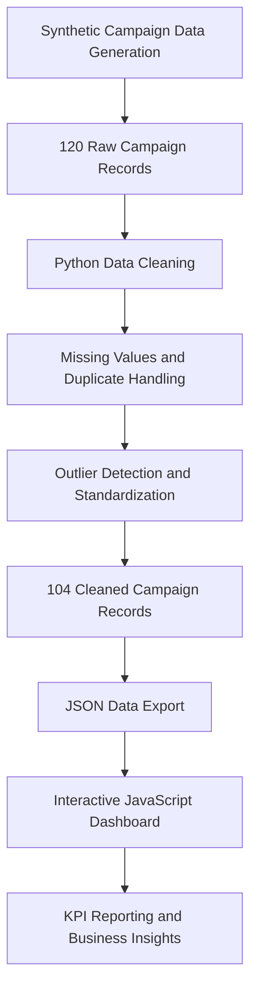

# 📊 Marketing Campaign Performance Dashboard

### Interactive Marketing Analytics | Campaign ROI | Conversion Funnel | Budget Optimization

   

## Project Overview

I developed an **interactive Marketing Campaign Performance Dashboard** to analyze advertising effectiveness, track campaign profitability, evaluate customer acquisition costs, and support data-driven marketing decisions.

Using **Python, HTML, CSS, JavaScript, and Chart.js**, I built an end-to-end analytics solution covering data generation, cleaning, exploratory analysis, KPI calculations, and interactive business intelligence reporting.

The dashboard consolidates campaign performance across six advertising platforms and provides actionable insights into marketing ROI, conversion efficiency, audience engagement, and budget allocation.

## Project Highlights

| Metric | Details |
|---|---|
| Raw Campaign Records | 120 |
| Cleaned Campaign Records | 104 |
| Advertising Platforms | 6 |
| Dataset Attributes | 20 |
| Interactive KPI Cards | 13 |
| Dashboard Visualizations | 11 |
| Dashboard Pages | Multiple interactive views |
| Data Processing | Python |
| Frontend | HTML, CSS, JavaScript |
| Visualization Library | Chart.js |

## Business Problem

Marketing teams often manage advertising campaigns across multiple platforms, making it difficult to evaluate performance, compare acquisition costs, and identify opportunities to improve profitability.

Disconnected reports and manual spreadsheet analysis can limit visibility into campaign effectiveness and delay marketing decisions.

I built this dashboard to provide a centralized analytics solution that enables:

- Real-time interaction with campaign performance metrics
- Advertising spend, revenue, and profitability analysis
- Cross-platform marketing performance comparisons
- Customer acquisition cost and conversion tracking
- Audience segmentation and regional analysis
- Identification of high-performing and underperforming campaigns
- Data-driven marketing budget optimization

## Technology Stack

| Category | Technologies |
|---|---|
| Programming Languages | Python 3.11+, JavaScript ES6 |
| Frontend Development | HTML5, CSS3 |
| Data Visualization | Chart.js 4.4 |
| Data Processing | Python, CSV, JSON |
| Data Analytics | EDA, KPI Analysis, Funnel Analysis |
| Statistical Analysis | IQR Outlier Detection, Correlation Analysis |
| Deployment | GitHub Pages |
| Version Control | Git, GitHub |

## Data Engineering and Processing Pipeline

I designed a Python-based data preparation workflow to transform raw campaign records into a structured dataset suitable for interactive reporting.



### Data Cleaning and Transformation

I implemented preprocessing steps to improve data consistency and analytical reliability.

1. Generated 120 synthetic marketing campaign records across six advertising platforms.
2. Handled missing numerical and categorical values.
3. Identified and removed duplicate campaign records.
4. Standardized campaign dates, advertising platform names, and audience segments.
5. Applied the **Interquartile Range (IQR)** method to identify and filter numerical outliers.
6. Calculated and validated campaign performance metrics.
7. Exported 104 cleaned records into JSON for dashboard integration.

**Result:** Transformed 120 raw campaign records into a structured dataset of 104 cleaned campaigns for marketing performance analysis.

## Marketing KPI Framework

I developed a marketing KPI framework to measure campaign profitability, advertising efficiency, customer acquisition, and conversion performance.

| KPI | Business Purpose |
|---|---|
| Marketing Spend | Measures total advertising investment |
| Revenue | Tracks campaign-generated revenue |
| Profit | Calculates revenue after advertising costs |
| ROI | Evaluates campaign profitability |
| CTR | Measures advertising engagement |
| CPC | Tracks average cost per click |
| CPM | Measures cost per 1,000 impressions |
| Conversion Rate | Evaluates lead conversion effectiveness |
| CAC | Measures cost per acquired customer |
| Negative ROI Campaigns | Identifies unprofitable campaigns |

### KPI Calculations

**Return on Investment (ROI)**

ROI = ((Revenue − Spend) / Spend) × 100

**Click-Through Rate (CTR)**

CTR = (Clicks / Impressions) × 100

**Cost Per Click (CPC)**

CPC = Spend / Clicks

**Customer Acquisition Cost (CAC)**

CAC = Spend / Conversions

**Lead-to-Conversion Rate**

Conversion Rate = (Conversions / Leads) × 100

These calculations power the dashboard's interactive KPI scorecards and campaign comparisons.

## Interactive Dashboard Features

### 1. Executive Performance Overview

I created an executive-level analytics interface featuring 13 KPI cards that summarize campaign financial performance and marketing efficiency.

The dashboard displays advertising spend, revenue, profitability, ROI, acquisition costs, and conversion performance.

KPI values update dynamically based on selected filters.

### 2. Campaign Performance Analysis

I developed interactive visualizations to compare campaign-level revenue, advertising investment, and ROI.

This analysis helps identify profitable campaigns, campaigns generating negative returns, and opportunities to improve marketing investment decisions.

### 3. Advertising Platform Performance

The dashboard compares performance across six marketing platforms:

- Google Ads
- Facebook
- Instagram
- LinkedIn
- Email
- YouTube

Platform-level analysis enables comparisons of revenue, ROI, engagement, and customer acquisition efficiency.

### 4. Conversion Funnel Analysis

I implemented a conversion funnel to visualize customer progression through four marketing stages.

**Impressions → Clicks → Leads → Conversions**

The funnel highlights customer drop-offs and supports the identification of potential conversion bottlenecks.

### 5. Audience Segmentation Analysis

I analyzed campaign performance across customer age groups to identify audience segments with stronger conversion rates and engagement.

### 6. Regional Marketing Performance

I developed geographic performance comparisons to evaluate regional differences in campaign ROI and advertising effectiveness.

### 7. Spend vs. Revenue Analysis

I implemented scatter plot visualizations to examine relationships between advertising spend, generated revenue, and ROI.

This helps identify campaigns with strong revenue performance relative to marketing investment.

### 8. Dynamic Dashboard Filters

I built interactive filtering capabilities using JavaScript.

Users can explore campaign performance by:

- Advertising platform
- Geographic region
- Campaign type
- Audience segment
- ROI category

Filters dynamically update KPI cards and dashboard visualizations.

### 9. Executive Strategy and Budget Optimization

I created a decision-support view that summarizes campaign performance and highlights opportunities to improve marketing efficiency.

The analysis supports decisions related to campaign prioritization, budget allocation, and customer acquisition strategy.

## Exploratory Data Analysis

I performed exploratory analysis to understand campaign behavior, identify performance patterns, and evaluate marketing efficiency.

The analysis covered:

- Numerical distribution analysis
- Correlation analysis and heatmaps
- Advertising platform comparisons
- Regional ROI analysis
- Audience segmentation
- Top-performing and underperforming campaigns
- Advertising spend versus revenue relationships
- Conversion funnel drop-off analysis

## Key Analytical Findings

The synthetic campaign dataset produced the following marketing performance insights.

| Analysis | Finding |
|---|---|
| Highest ROI Campaign | Summer Sale 2024, 325% ROI |
| Highest Average Platform ROI | Google Ads, 280% |
| Strongest Audience Segment | Ages 25–34, 28% conversion rate |
| Leading Geographic Region | North America, 260% average ROI |
| Email Marketing Performance | 5.5% CTR and $85 CAC |
| Awareness Campaign Performance | 145% average ROI |

### Business Insights

**Campaign profitability:** Summer Sale 2024 achieved the highest reported campaign ROI at 325%, demonstrating the value of campaign-level profitability analysis.

**Channel performance:** Google Ads recorded the strongest average platform ROI at 280%, making it a priority channel for further budget allocation analysis.

**Audience targeting:** The 25–34 age segment achieved a 28% conversion rate, highlighting opportunities for more targeted marketing strategies.

**Regional performance:** North America generated a 260% average ROI, indicating strong performance within the simulated campaign portfolio.

**Email marketing:** Email campaigns recorded a 5.5% CTR and $85 CAC, providing useful benchmarks for comparing engagement and acquisition efficiency.

These findings illustrate how campaign analytics can support marketing decisions using a synthetic business dataset.

## Project Architecture

```text
marketing-campaign-performance-dashboard/
│
├── data/
│   ├── campaign_data.csv
│   └── cleaned_campaign_data.csv
│
├── docs/
│   ├── index.html
│   ├── script.js
│   ├── style.css
│   └── data.json
│
├── scripts/
│   └── generate_data.py
│
├── screenshots/
│
├── requirements.txt
├── LICENSE
└── README.md
```

## Installation and Setup

### 1. Clone the Repository

```bash
git clone https://github.com/ds2204/marketing-campaign-performance-dashboard.git
cd marketing-campaign-performance-dashboard
```

### 2. Create a Virtual Environment

```bash
python3 -m venv .venv
source .venv/bin/activate
```

### 3. Install Dependencies

```bash
pip install -r requirements.txt
```

### 4. Generate and Process Campaign Data

```bash
python scripts/generate_data.py
```

### 5. Launch the Dashboard

```bash
python -m http.server 8000 --directory docs
```

Open the dashboard at:

`http://localhost:8000`

The local server enables the dashboard to load JSON data through JavaScript's `fetch()` API.

## Testing and Validation

I tested the dashboard's core analytical and interactive components, including:

- Rendering of 11 dashboard visualizations
- Interactive page navigation
- Dynamic filtering functionality
- Marketing KPI calculations
- Campaign dataset generation and preprocessing
- Dashboard responsiveness to user selections

## Future Enhancements

I plan to extend the dashboard with additional analytical and automation capabilities.

- **Predictive analytics:** Forecast campaign revenue, conversions, and ROI.
- **API integration:** Connect Google Ads and other marketing platforms for live data ingestion.
- **Automated data pipelines:** Schedule recurring campaign data refreshes.
- **Historical analysis:** Track campaign performance over time.
- **Budget optimization:** Introduce scenario-based advertising spend allocation.
- **KPI monitoring:** Add configurable targets, thresholds, and performance alerts.

## Skills Demonstrated

**Data Analytics:** Exploratory Data Analysis | Marketing Analytics | KPI Development | ROI Analysis | Conversion Funnel Analysis | Audience Segmentation | Statistical Analysis

**Technical Tools:** Python | JavaScript | HTML5 | CSS3 | Chart.js | CSV | JSON | Git | GitHub

**Business Intelligence:** Interactive Dashboard Development | Executive Reporting | Performance Monitoring | Marketing Attribution Analysis | Budget Optimization | Data-Driven Decision Support

---

**Project Focus:** Marketing Analytics | Business Intelligence | Python | Interactive Data Visualization | Campaign ROI | KPI Reporting | Marketing Performance Optimization

**GitHub:** [ds2204](https://github.com/ds2204)
