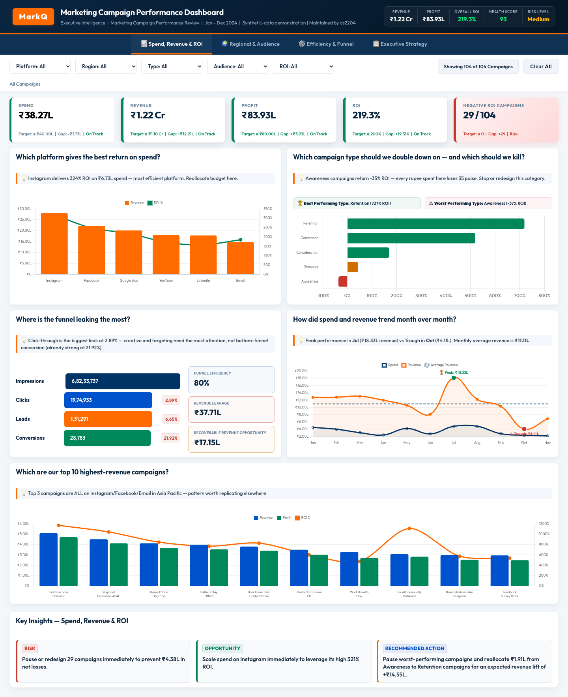
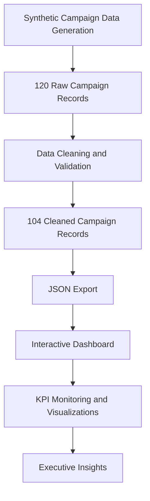

# 📊 Marketing Campaign Performance Dashboard

### Interactive Marketing Analytics | Campaign ROI | Conversion Funnel | Budget Optimization

   

An interactive business intelligence dashboard designed to analyze digital marketing campaigns, monitor financial performance, compare advertising channels, and identify opportunities for improving marketing ROI.

Built with **Python, HTML, CSS, JavaScript, and Chart.js**, the project combines data preparation, KPI calculations, interactive visualizations, and executive-level reporting.

## Project at a Glance

| Metric | Project Details |
|---|---|
| Raw Campaigns | 120 synthetic records |
| Cleaned Campaigns | 104 records |
| Advertising Platforms | 6 |
| Dataset Attributes | 20 |
| KPI Cards | 13 |
| Dashboard Visualizations | 11 |
| Dashboard Technology | HTML, CSS, JavaScript, Chart.js |
| Data Processing | Python |

## Business Problem

Marketing teams need a reliable way to understand campaign performance across multiple advertising platforms.

Traditional spreadsheet reports can make it difficult to identify underperforming campaigns, compare acquisition costs, and evaluate return on marketing spend.

This dashboard addresses those challenges through a centralized analytical interface that supports:

- Campaign performance monitoring
- Marketing spend and revenue analysis
- Customer acquisition cost tracking
- Channel and audience comparisons
- Conversion funnel analysis
- Regional performance evaluation
- Data-driven budget allocation decisions

## Dashboard Preview

The project includes an interactive, multi-page dashboard with KPI scorecards, dynamic filters, charts, and executive insights.

To display an actual screenshot here, save a screenshot of the running dashboard as:

`screenshots/dashboard_overview.png`

Then add this Markdown to your README:

```markdown

```

Do not add the image reference until the PNG exists in the repository.

## Technology Stack

| Category | Technologies |
|---|---|
| Programming | Python 3.11+, JavaScript |
| Frontend | HTML5, CSS3 |
| Visualization | Chart.js 4.4 |
| Data Processing | Python, CSV, JSON |
| Analytics | KPI Analysis, EDA, Funnel Analysis |
| Statistical Methods | IQR Outlier Detection, Correlation Analysis |
| Hosting Support | GitHub Pages |
| Version Control | Git, GitHub |

## Data Pipeline



### Data Preparation

The documented pipeline includes:

1. Generating synthetic campaign records.
2. Handling missing numerical and categorical values.
3. Identifying and removing duplicate records.
4. Standardizing dates, platform names, and audience segments.
5. Applying the interquartile range method to selected numerical fields.
6. Validating marketing KPI calculations.
7. Exporting cleaned records for dashboard consumption.

The cleaned dataset contains 104 campaign records after preprocessing.

## Marketing KPIs

The dashboard analyzes campaign performance using metrics such as:

| KPI | Purpose |
|---|---|
| Marketing Spend | Total campaign investment |
| Revenue | Revenue attributed to campaigns |
| Profit | Revenue minus marketing spend |
| ROI | Return relative to campaign investment |
| CTR | Percentage of impressions generating clicks |
| CPC | Average cost per click |
| CPM | Cost per thousand impressions |
| Conversion Rate | Lead-to-conversion effectiveness |
| CAC | Marketing cost per acquired customer |
| Negative ROI Campaigns | Campaigns generating a loss |

### Core Calculations

**Return on Investment**

\[
ROI=\frac{Revenue-Spend}{Spend}\times100
\]

**Click-Through Rate**

\[
CTR=\frac{Clicks}{Impressions}\times100
\]

**Cost Per Click**

\[
CPC=\frac{Spend}{Clicks}
\]

**Customer Acquisition Cost**

\[
CAC=\frac{Spend}{Conversions}
\]

**Lead-to-Conversion Rate**

\[
Conversion\ Rate=\frac{Conversions}{Leads}\times100
\]

## Dashboard Features

### 1. Executive KPI Overview

An executive-style dashboard summarizing marketing spend, revenue, profitability, acquisition costs, and campaign efficiency.

Includes dynamic KPI cards that respond to selected filters.

### 2. Campaign Performance Analysis

Interactive visualizations compare campaign ROI and revenue, helping users identify high-performing and low-performing campaigns.

### 3. Platform Performance

Compares marketing results across:

- Google Ads
- Facebook
- Instagram
- LinkedIn
- Email
- YouTube

### 4. Conversion Funnel

Tracks the customer journey:

**Impressions → Clicks → Leads → Conversions**

The funnel helps visualize conversion losses between stages and identify opportunities for improvement.

### 5. Audience and Regional Analysis

Evaluates performance across customer age groups and geographic regions.

### 6. Spend vs. Revenue Analysis

Scatter plots help examine the relationship between campaign investment, generated revenue, and ROI.

### 7. Interactive Filters

The dashboard supports filtering by platform, region, campaign type, audience segment, and ROI category.

Selected filters update the displayed performance metrics and visualizations.

### 8. Executive Strategy View

A decision-support section presents campaign performance summaries and potential optimization opportunities.

Any financial projections should be interpreted as scenario estimates based on synthetic data.

## Exploratory Data Analysis

The project documentation describes several analytical approaches:

- Numerical distribution analysis
- Correlation heatmaps
- Platform-level comparisons
- Regional performance comparisons
- Audience segmentation
- Top and bottom campaign rankings
- Spend and ROI relationships
- Conversion funnel drop-off analysis

## Key Analytical Findings

The original project documentation reports the following results from its synthetic campaign data.

| Analysis | Reported Finding |
|---|---|
| Top Campaign | Summer Sale 2024, 325% ROI |
| Highest Average Platform ROI | Google Ads, 280% |
| Strongest Audience Segment | Ages 25–34, 28% conversion rate |
| Leading Region | North America, 260% average ROI |
| Email Marketing | 5.5% CTR and $85 CAC |
| Awareness Campaigns | 145% average ROI |

These figures are documented historical outputs and should be recalculated against the cleaned dataset before being treated as verified results.

Because the dataset is synthetic, the findings demonstrate analytical methods rather than actual advertising performance.

## Project Structure

```text
marketing-campaign-performance-dashboard/
├── data/
│   ├── campaign_data.csv
│   └── cleaned_campaign_data.csv
├── docs/
│   ├── index.html
│   ├── script.js
│   ├── style.css
│   └── data.json
├── scripts/
│   └── generate_data.py
├── screenshots/
├── requirements.txt
├── LICENSE
└── README.md
```

Additional documentation and audit files may be present in the cleaned repository.

## Installation and Setup

### 1. Clone the Repository

Once published under `ds2204`:

```bash
git clone https://github.com/ds2204/marketing-campaign-performance-dashboard.git
cd marketing-campaign-performance-dashboard
```

### 2. Create a Virtual Environment

```bash
python3 -m venv .venv
source .venv/bin/activate
```

### 3. Install Dependencies

```bash
pip install -r requirements.txt
```

### 4. Generate and Clean the Dataset

```bash
python scripts/generate_data.py
```

### 5. Launch the Dashboard

```bash
python -m http.server 8000 --directory docs
```

Open:

`http://localhost:8000`

The local web server is required because the dashboard loads JSON data using the browser's `fetch` API.

## Testing and Validation

The repository cleanup report indicated successful checks of:

- 11 dashboard charts
- Navigation and filtering
- KPI calculations
- Dataset regeneration
- Dashboard interactions

Browser compatibility, hosting configuration, and the final GitHub Pages deployment should be verified separately.

## Future Improvements

- Add campaign performance forecasting.
- Integrate live advertising platform APIs.
- Introduce automated scheduled data refreshes.
- Add historical campaign comparisons.
- Expand budget optimization scenarios.
- Implement user-defined KPI targets and alerts.

## Licensing and Attribution

The repository includes an MIT license. Preserve its existing copyright notices and any required attribution.

This project is maintained under [ds2204](https://github.com/ds2204).

---

**Focus Areas:** Marketing Analytics | Business Intelligence | Python | Data Visualization | KPI Reporting | Dashboard Development
